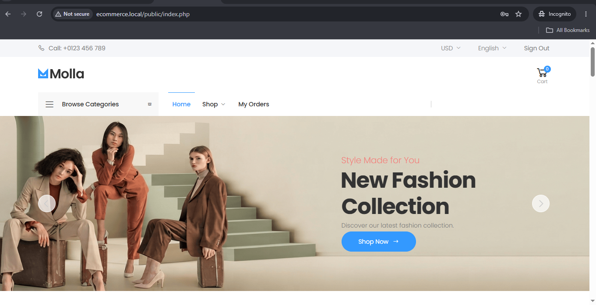
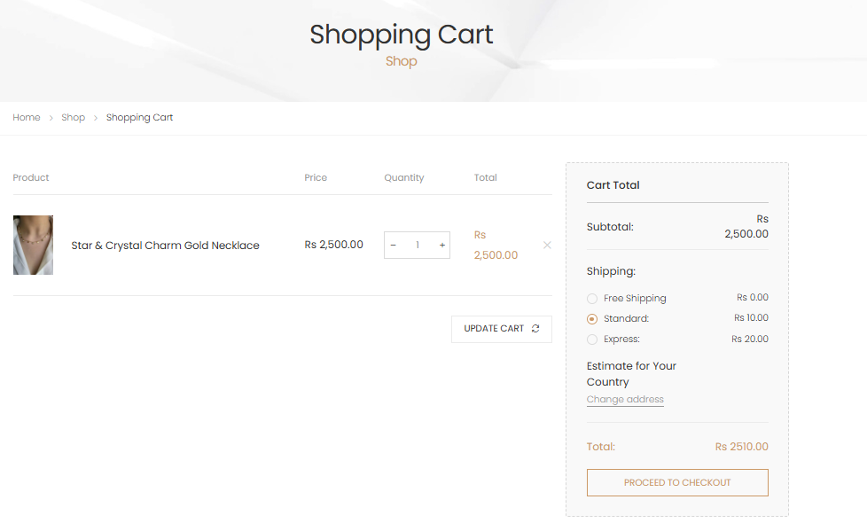
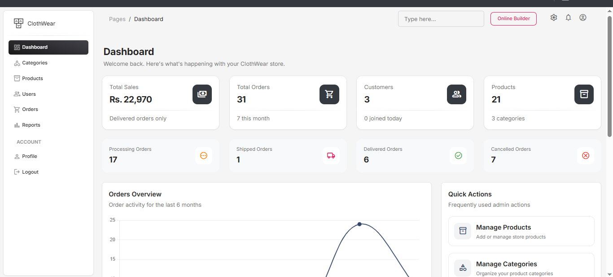

# ClothWear — E-Commerce Website

ClothWear is a full-stack PHP/MySQL e-commerce website with a customer storefront and admin panel. It includes product browsing, category filtering, search, multi-image products, cart and shipping options, Cash on Delivery and Stripe checkout, order confirmation and status handling, email notifications, and an admin dashboard with sales reports.

## Features

### Customer

* User registration and login
* Product search
* Category-based product browsing
* Product details with multiple images
* Add to cart
* Stock validation
* Free, Standard, and Express shipping
* Cash on Delivery
* Stripe checkout
* Order confirmation
* Order status updates
* Email notifications

### Admin

* Admin authentication
* Dashboard statistics
* Category management
* Product management
* Product image management
* Customer/user management
* Order management
* Order status handling
* Today, Weekly, Monthly, and Yearly reports
* Delivered-order sales analysis
* Products ranked by units sold from delivered orders

## Tech Stack

* PHP
* MySQL
* PDO
* HTML5
* CSS3
* JavaScript
* Bootstrap
* Molla E-Commerce Theme
* Material Dashboard
* Stripe PHP SDK
* PHPMailer
* Composer
* Apache / WAMP

## Setup

Follow these steps to run the project locally.

### 1. Requirements

Install the following:

* WAMP
* PHP
* MySQL
* Composer
* Git

### 2. Clone the Repository

```bash
git clone https://github.com/Ishratalib/e-commerce.git
cd e-commerce
```

### 3. Install Dependencies

Run:

```bash
composer install
```

### 4. Create the Database

Open phpMyAdmin:

```text
http://localhost/phpmyadmin
```

Create a database named:

```text
ecommerce
```

Then import the SQL file included in the repository:

```text
database/sql database.sql
```

This file contains the required database structure and demo data.

### 5. Configure Database Connection

Set your local MySQL credentials in:

```text
config/database.php
```

Use your own local database username and password.

Do not add real database credentials to GitHub.

### 6. Configure Stripe

The repository does not contain private Stripe credentials.

Add your own Stripe test credentials in the local Stripe configuration used by the project.

Never commit Stripe secret keys to GitHub.

### 7. Configure Email

The project uses PHPMailer for order and order-status email notifications.

Configure your own SMTP/email credentials in the local mail configuration.

Do not commit personal email passwords or SMTP credentials.

### 8. Start the Project

Start **Apache** and **MySQL** from WAMP.

Open the project using your local URL:

```text
http://ecommerce.local/
```

## Demo Accounts

The included database uses demo accounts.

### Admin

```text
Email: admin@clothwear-demo.test
Password: DemoAdmin@123
```

### Customer

```text
Email: customer1@clothwear-demo.test
Password: DemoCustomer@123
```

## Database Tables

The project includes the following main tables:

```text
users
customer_details
categories
products
deals
cart
cart_items
orders
order_items
sliders
```

The SQL dump includes the database structure and demo data needed to run the application.

## Screenshots

### Homepage



### Categories


### Women Products


### Men Products


### Accessories Products


### Shopping Cart



### Admin Dashboard



## Payment Integration

The checkout system supports:

* Cash on Delivery
* Stripe

Private Stripe credentials are not included in the repository.

## Email Notifications

PHPMailer is used to send order-related and order-status email notifications.

Email credentials are kept outside the public repository.

## Product Images

Product and category images are included in:

```text
public/uploads/
```

The project supports multiple images for individual products.

## Project Structure

```text
e-commerce/
├── admin/
├── config/
├── core/
├── database/
│   └── sql database.sql
├── includes/
├── public/
│   ├── assets/
│   └── uploads/
├── screenshots/
│   ├── homepage.PNG
│   ├── categories.PNG
│   ├── women products.PNG
│   ├── men products.PNG
│   ├── acessories products.PNG
│   ├── cart.PNG
│   └── admin-dashboard.PNG
├── composer.json
├── composer.lock
├── index.php
└── .gitignore
```

## Security

The repository does not contain:

* Real database passwords
* Stripe secret keys
* SMTP/email passwords
* Environment secrets
* Real customer/payment information

Use your own local credentials when configuring the project.

## Author

**Ishrat Talib**

BS Computer Science — Bahria University Karachi Campus
MS Computer Science
